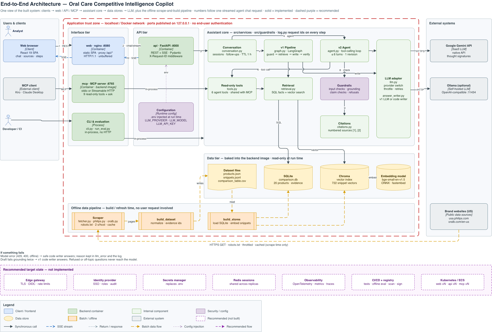
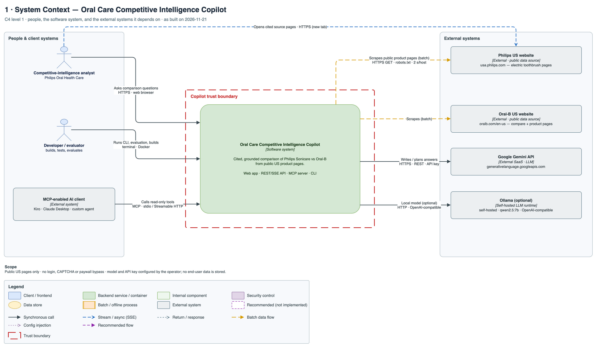
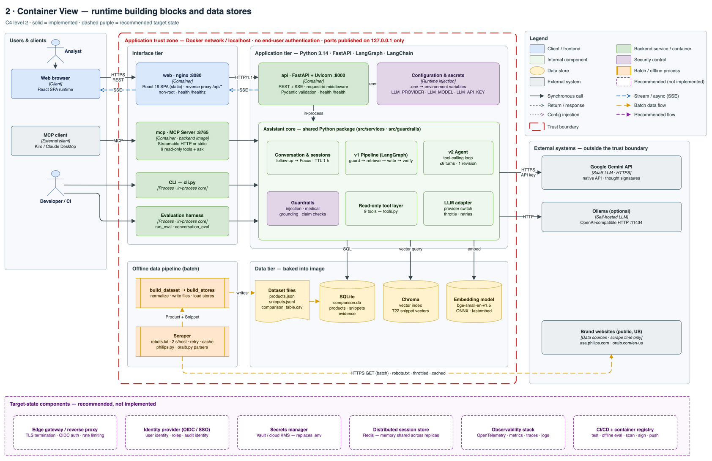
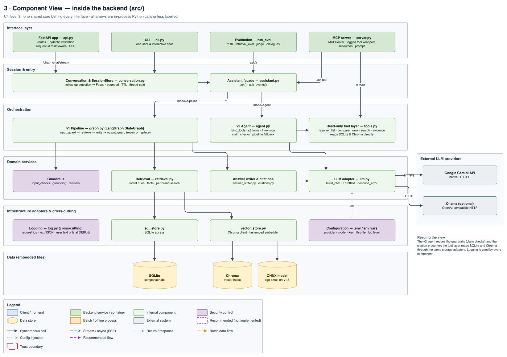
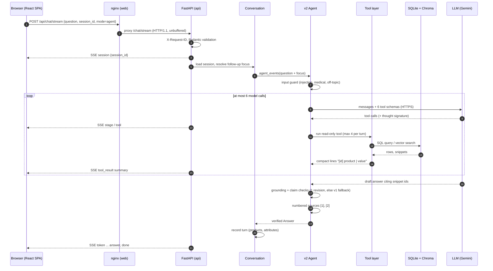
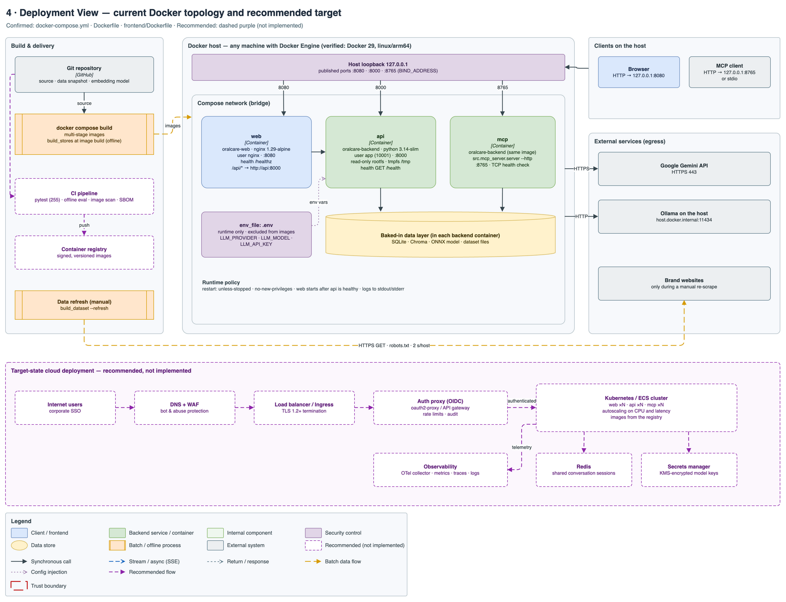
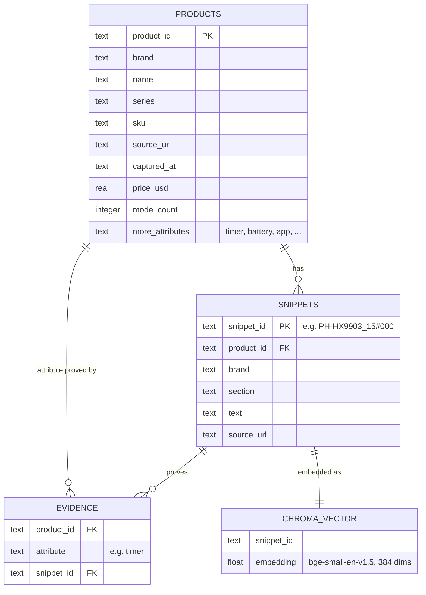
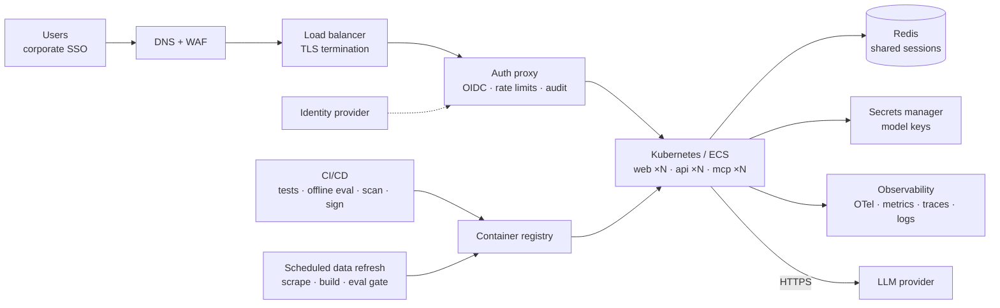

# Architecture: Oral Care Competitive Intelligence Copilot

This document describes how the copilot is built, how a question flows through it, how it is deployed, and what we
recommend before it serves more than one trusted user.
Every statement is tagged so you can tell what is real from what is proposed:

| Tag | Meaning |
|---|---|
| **Confirmed** | Read in the code or config, or run and observed. File paths are given. |
| **Assumption** | Not stated anywhere in the project; we assumed it to make a design call. |
| **Recommended** | Not implemented. A proposal for the target state. |

Diagrams in this folder:

| File | What it shows |
|---|---|
| [`end-to-end-architecture.drawio`](end-to-end-architecture.drawio) ([PNG](end-to-end-architecture.png)) | Everything on one page: clients, containers, core modules, stores, external systems, the offline pipeline and the numbered request path |
| [`architecture.drawio`](architecture.drawio) | Five pages: system context, containers, components, deployment, end-to-end data flow |
| PNG copies | [`1-system-context.png`](1-system-context.png), [`2-containers.png`](2-containers.png), [`3-components.png`](3-components.png), [`4-deployment.png`](4-deployment.png), [`5-data-flow.png`](5-data-flow.png) |

Conventions in all diagrams: solid = implemented, dashed purple = recommended, red dashed frame = trust boundary,
solid arrow = synchronous call, blue dashed = server-sent events (SSE), grey dashed = response, orange dashed =
batch data, dotted purple = configuration injected at run time.

## 1. Purpose and scope

The copilot answers comparison questions about Philips Sonicare and Oral-B electric toothbrushes, using only the
public US product pages named in the case-study brief. Every fact in an answer carries a numbered citation that
links to the page it came from. If the sources do not contain a fact, the answer says "not found in sources".

- **In scope (Confirmed):** 20 products (12 Philips, 8 Oral-B), 722 text snippets, 377 field-level evidence links.
  A chat assistant (v1 pipeline), an optional tool-calling agent (v2), a REST/SSE API, an MCP server, a CLI, a React
  web app, an evaluation suite, and Docker packaging.
- **Out of scope (Confirmed, by design):** logins, CAPTCHAs, paywalls, non-US pages, medical advice, and any
  end-user data storage beyond in-memory conversation state.

## 2. System context

| Actor or system | Interaction | Protocol | Status |
|---|---|---|---|
| Competitive-intelligence analyst | Asks questions, opens cited pages | HTTPS in a browser (HTTP on localhost today) | Confirmed |
| Developer / evaluator | Runs the CLI, the evaluation, the builds | Terminal, Docker | Confirmed |
| MCP-enabled AI client (Kiro, Claude Desktop) | Calls read-only tools | MCP over stdio or Streamable HTTP | Confirmed |
| usa.philips.com, oralb.com/en-us | Scraped at build time only | HTTPS GET, robots.txt honoured, 2 s per host | Confirmed (`src/scraping/fetcher.py`) |
| Google Gemini API | Writes answers; plans tool calls in v2 | HTTPS, API key, native `langchain-google-genai` | Confirmed (`src/services/llm.py`) |
| Ollama (optional) | Self-hosted alternative model | OpenAI-compatible HTTP | Confirmed (`LLM_BASE_URL`) |

The model is never required. With no model configured, a deterministic code writer produces the answer from the
same verified facts (Confirmed, `src/services/answer_writer.py`).

## 3. Containers and processes

| Container / process | Technology | Responsibility | Port | Status |
|---|---|---|---|---|
| `web` | nginx 1.29-alpine serving the React 19 build | Serves the SPA; proxies `/api/*` to `api` with buffering off so SSE streams | 8080 | Confirmed (`frontend/Dockerfile`, `frontend/nginx.conf.template`) |
| `api` | Python 3.14, FastAPI, Uvicorn | `/chat`, `/chat/stream` (SSE), `/sessions/{id}`, `/products`, `/snippets/{id}`, `/compare`, `/health` | 8000 | Confirmed (`src/app/api.py`) |
| `mcp` | Same backend image, `src.mcp_server.server --http` | 9 read-only tools + `ask`, 2 resources, 1 prompt | 8765 | Confirmed (`src/mcp_server/server.py`) |
| CLI | `python -m src.app.cli` | Ask questions from a terminal, in-process | none | Confirmed |
| Evaluation | `python -m src.evaluation.run_eval` | Test questions, ground truth, retrieval recall, judge, gates | none | Confirmed |
| Offline pipeline | `src.pipeline.build_dataset`, `build_stores` | Scrape, normalise, write files, load SQLite and Chroma | none | Confirmed |

The API, MCP server, CLI and evaluation all call the same in-process Python package. There is no internal network
hop between the API and the assistant core.

## 4. Components (inside the backend)

| Module | Responsibility |
|---|---|
| `services/conversation.py` | Sessions (in memory, max 200, 1 h idle TTL); decides whether a question is a follow-up and carries over the product or attribute focus |
| `services/graph.py` | v1 pipeline as a LangGraph workflow: input guard → retrieve → write → output guard |
| `services/agent.py` | v2 agent: model chooses from 6 tools, at most 6 model calls and 4 tool calls per turn, 1 revision; falls back to v1 with no extra model call |
| `services/tools.py` | 9 read-only tools shared by the agent, the API and MCP (one registry, so they cannot drift) |
| `services/retrieval.py` | Exact facts from SQLite plus semantic search over snippets in Chroma |
| `services/answer_writer.py` | LLM writer, or deterministic code writer when there is no model or it fails |
| `services/llm.py` | Provider switch (Google native or OpenAI-compatible), minimum interval between calls, retries |
| `services/citations.py` | Turns snippet ids into numbered sources `[1]`, `[2]`, one per page |
| `guardrails/input_checks.py` | Rejects empty, over-long (600 chars), prompt-injection, medical and off-topic questions before any retrieval |
| `guardrails/grounding.py` | Every claim must cite an allowed snippet id; numbers and missing items are checked |
| `guardrails/refusals.py` | Fixed refusal texts |
| `storage/sql_store.py`, `vector_store.py` | SQLite access and the Chroma collection with local ONNX embeddings |
| `common/log.py` | Structured logs, one request id across all steps, secret and user-text redaction |

## 5. End-to-end request flow

The sequence below is one streamed chat request in agent mode, as the web app sends it. Page 5 of
`architecture.drawio` draws the same flow with all 22 steps.

What happens when something fails (Confirmed):

- **Model error** (429, 400, offline): the code writer answers from the same facts; the reason is kept in
  `llm_error` and the log.
- **Draft fails grounding twice:** the v1 code writer answers; the reason is in `fallback_reason`.
- **Refused or off-topic question:** ends at the input guard and never reaches retrieval or the model.
- **Stream error:** the API sends an `error` event, then `done`, so the browser never hangs.

## 6. Offline data pipeline

```mermaid
flowchart LR
    sites["Brand websites<br/>Philips · Oral-B (US)"]
    fetch["Fetcher<br/>robots.txt · 2 s/host<br/>retry · cache data/raw"]
    parse["Site parsers<br/>philips.py · oralb.py"]
    build["build_dataset<br/>normalise · evidence ids"]
    files[("products.json<br/>snippets.jsonl<br/>comparison_table.csv")]
    stores["build_stores<br/>load SQLite · embed snippets"]
    db[("SQLite + Chroma<br/>20 products · 722 snippets")]
    img["Backend image<br/>read-only at run time"]

    sites -->|HTTPS GET| fetch -->|HTML| parse -->|Product + Snippet| build --> files --> stores --> db -->|baked in at image build| img
```

The pipeline runs by hand (`build_dataset --refresh`), never during a user request. The Docker build runs
`build_stores` so the image ships with ready stores (Confirmed, `Dockerfile`).

## 7. Deployment

Current topology (Confirmed, `docker-compose.yml`, `Dockerfile`, `frontend/Dockerfile`):

| Aspect | Current state |
|---|---|
| Hosts | One Docker host; verified on Docker 29, linux/arm64 |
| Images | `oralcare-backend` (python:3.14-slim, about 1.3 GB with the ONNX model) used by `api` and `mcp`; `oralcare-web` (nginx, about 93 MB) |
| Network | One Compose bridge network; `web` reaches `api` as `http://api:8000` |
| Exposure | Every port published on `${BIND_ADDRESS:-127.0.0.1}` only |
| Runtime hardening | Non-root users (`app` uid 10001, `nginx`), read-only root filesystem with tmpfs `/tmp` for the backend, `no-new-privileges`, `restart: unless-stopped` |
| Health | `api` `/health`, `mcp` TCP check, `web` `/healthz`; `web` starts after `api` is healthy |
| Configuration | `.env` read at run time via `env_file` (optional); excluded from both images by `.dockerignore` |
| Logs | stdout/stderr, collected by `docker compose logs` |
| Local model | `host.docker.internal:11434` reaches Ollama on the host |

Without Docker, the API binds to `127.0.0.1:8000` and the Vite dev server to `127.0.0.1:5173`
(`HOST` and `MCP_HOST` change the bind address; default is loopback).

## 8. Data architecture

`PRODUCTS`, `SNIPPETS` and `EVIDENCE` are SQLite tables (`src/storage/sql_store.py`); `CHROMA_VECTOR` is the Chroma
collection (`src/storage/vector_store.py`).

Key ideas (Confirmed):

- **Every field keeps its proof.** A product attribute is only stored with the snippet ids that support it, so an
  answer can cite the exact sentence on the exact page.
- **Two stores, two jobs.** SQLite answers exact questions (price, battery, modes) and holds the evidence links.
  Chroma finds snippets by meaning. Embeddings are computed locally (ONNX, fastembed), so no data leaves the
  machine for retrieval.
- **Read-only at run time.** The stores are baked into the image; the running service never writes to them.
- **No user data at rest.** Conversations live in process memory and expire after 1 h idle.

## 9. Security and trust boundaries

Trust boundaries (Confirmed): the browser and MCP clients are outside; `web`, `api`, `mcp` and the data stores are
inside one trust zone (localhost or the Compose network); Gemini, Ollama and the brand websites are external.

| Control | Current state | Status |
|---|---|---|
| Authentication / authorisation | None. The API and MCP server have no login and no CORS | Confirmed gap, mitigated by loopback-only binding |
| Network exposure | All ports on 127.0.0.1 by default; compose warns against `0.0.0.0` without an auth proxy | Confirmed |
| Transport | Plain HTTP on localhost; HTTPS only to Gemini and the brand sites | Confirmed |
| Secrets | API key only in `.env` at run time; never in images; redacted from logs | Confirmed |
| Input validation | Pydantic models (question up to 2000 chars at the API, 600 in the guard), product lists capped at 6 | Confirmed; the two limits differ (see §12) |
| Prompt injection | Input guard rejects known patterns; tools are read-only, so a hijacked model cannot change data | Confirmed |
| Output integrity | Grounding check: every claim must cite an allowed snippet id; numbers are checked against the source | Confirmed |
| Tool safety | Tool results capped at 8000 characters; at most 4 tool calls per turn, 6 model calls per question | Confirmed |
| Model cost / abuse | Minimum interval between model calls (`LLM_MIN_INTERVAL`) and retries; no per-user rate limit | Confirmed gap |
| Container hardening | Non-root, read-only root filesystem, `no-new-privileges` | Confirmed |
| Scraping compliance | robots.txt honoured, 2 s per host, public pages only | Confirmed (`docs/scraper/robots-txt-check.md`) |

## 10. Quality attributes

| Attribute | How it is met today | Status |
|---|---|---|
| Correctness / grounding | Code picks facts in v1; claim checks and one revision in v2; "not found in sources" for missing data | Confirmed |
| Availability of answers | Works without any model; model failure falls back to the code writer | Confirmed |
| Performance | Local retrieval (no network); one model call in v1, up to 6 in v2; streaming so text appears early | Confirmed design; no load test has been run |
| Scalability | Single process per container; sessions in memory, so replicas would not share conversations | Confirmed limit |
| Observability | Structured logs with a request id across API, pipeline, model calls, agent and MCP; JSON option | Confirmed; no metrics or traces |
| Testability | 255 tests, none need a model, network or quota; a guard in `conftest.py` blocks real model calls | Confirmed |
| Evaluability | 41 test questions, ground truth, retrieval recall, multi-turn dialogues, optional LLM judge, quality gates | Confirmed |
| Portability | Docker images for every part; one `docker compose up` | Confirmed |

## 11. Key design decisions

| Decision | Why | Trade-off |
|---|---|---|
| Field-level evidence in the data model | Citations become exact and checkable | More work in the parsers |
| SQLite + Chroma instead of a vector store alone | Exact facts must not depend on similarity search | Two stores to build and keep in step |
| Local ONNX embeddings | No data leaves the machine; no extra API quota | About 130 MB model in the image; CPU cost at build |
| v1 pipeline as the default answer path, v2 agent optional | Code-chosen retrieval is predictable and cheap; the agent adds flexibility | Two paths to maintain; shared guards keep them consistent |
| One tool registry for agent, API and MCP | The three surfaces cannot drift apart | Tools must suit both models and humans |
| Deterministic fallback writer | Answers survive model outages and quota limits | Plainer wording |
| Stores baked into the image, read-only | Reproducible, no runtime writes, safe read-only root filesystem | Refreshing data means rebuilding the image |
| Loopback-only by default | No auth yet, so no accidental exposure | Remote use needs a proxy first |

## 12. Known gaps and risks

| Gap | Impact | Suggested fix |
|---|---|---|
| No authentication, TLS or rate limiting | Anyone who can reach a published port can use it and spend model quota | Edge gateway with OIDC and per-user limits (§13) |
| Sessions in memory | Lost on restart; not shared across replicas | Redis-backed `SessionStore` |
| Question length: API allows 2000, guard allows 600 | Long questions pass validation, then get refused | Align `MAX_QUESTION_CHARS` with `MAX_QUESTION_LENGTH` |
| Manual data refresh | Prices and models go stale | Scheduled refresh job with a diff report and the evaluation as a gate |
| Parser coupling to page markup | A site redesign breaks extraction silently | Scheduled scrape with schema and count checks |
| Single model provider in practice (Gemini free tier) | Quota limits cap throughput | Paid tier or a second provider behind `llm.py` |
| Logs only, no metrics or traces | Hard to see latency, error rates and model cost | OpenTelemetry |
| No CI pipeline | Tests and offline evaluation run by hand | CI with tests, offline eval, image scan, SBOM |

## 13. Recommended target state

All items in this section are **Recommended** (not implemented).

Suggested order, smallest risk first:

1. Align the question-length limits; add CI with the existing tests and the offline evaluation.
2. Put an auth proxy with TLS and per-user rate limits in front of `web`, `api` and `mcp`.
3. Move the model key to a secrets manager; add OpenTelemetry.
4. Move sessions to Redis, then run more than one replica.
5. Schedule the data refresh, with the evaluation as a release gate for the new image.

## 14. Assumptions

- **Assumption:** the first users are a small, trusted analyst team, so low concurrency is acceptable today.
- **Assumption:** weekly or monthly data freshness is enough for competitive analysis; real-time prices are not
  needed.
- **Assumption:** the brand sites remain publicly reachable without login, and their robots.txt rules stay as
  checked on 2026-11-20.
- **Assumption:** a cloud target would be a container platform (Kubernetes or ECS); nothing in the code ties it to
  one.

## Related documents

- [`../report.md`](../report.md): approach, design choices and limitations
- [`../scraper/scraping-insights.md`](../scraper/scraping-insights.md): the scraper
- [`../assistant/assistant-insights.md`](../assistant/assistant-insights.md): the v1 assistant
- [`../agent/agent-insights.md`](../agent/agent-insights.md): the agent, tools and MCP
- [`../frontend/frontend-insights.md`](../frontend/frontend-insights.md): the web app
