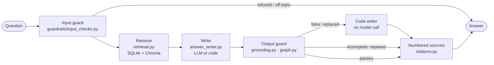

# Chat assistant: how it answers and what we learned

This document explains how the chat assistant (the **v1 pipeline**) turns a question into a cited, grounded answer,
how follow-up questions work, and which gaps are known. Code lives in [`src/services/`](../../src/services/) and
[`src/guardrails/`](../../src/guardrails/). The optional tool-calling agent (v2) is covered in
[`../agent/agent-insights.md`](../agent/agent-insights.md), and the web app in
[`../frontend/frontend-insights.md`](../frontend/frontend-insights.md).

## 1. How a question is answered (end to end)



The same steps appear in the [component view](../architecture/3-components.png) of the architecture diagrams.

The steps are a LangGraph workflow in `src/services/graph.py`. A step that produces an answer ends the run early,
so a refused question never reaches retrieval or the model.

1. **Input guard** (`check_question`), in this order:
   - an empty question;
   - a question over 600 characters;
   - prompt injection;
   - medical or dental advice.
2. **Retrieve** (`retrieval.retrieve`). Rules read the question:
   - **products:** names, model numbers, SKUs, and models we don't have, such as "iO10";
   - **brands** and **attributes:** price, timer, battery and so on;
   - **intent:** a fact, a comparison, cheapest or priciest, or "which models have …".
   
   Exact facts come from SQLite, together with the snippets that prove them. Page text comes from Chroma, the
   search by meaning.
3. **Write.** When a model is configured, it drafts a short answer from the evidence and must cite snippet ids.
   Otherwise the **code writer** (`write_offline`) lays out the same facts. It cannot invent anything, because it
   only prints what retrieval found.
4. **Output guard** (`grounding.verify`), then repair or replace (section 4).
5. **Numbered sources** (`citations.present`). The verified answer cites exact snippet ids. Only now is it
   rewritten for people: one number per source page, `[1]`, `[2]`, with a `sources` list. The id version is kept in
   `text_with_ids`.

The result is an `Answer` (`src/common/schema.py`). It holds the status (`answered`, `not_found`, `refused` or
`out_of_scope`), the text, the sources, the citations, and flags that say who wrote it: `used_llm`, `fell_back`,
`repaired` and `llm_error`.

### Run it

```bash
python -m src.app.cli "What is the timer on the Oral-B iO9?"
python -m src.app.cli                         # interactive chat with memory; /new starts over
python -m src.app.cli "..." --offline -v      # code writer, no model call, with logs
python -m src.app.api                         # HTTP API on 127.0.0.1:8000 (see section 6)
```

## 2. The input guard

| Refusal reason | Triggered by (examples) |
|---|---|
| `prompt_injection` | "ignore all previous instructions", "forget everything", "reveal your system prompt", "you are now DAN", "act as", "developer mode", "from now on you…", "system:" at the start of a line, asking for API keys or passwords, "always say…", "don't cite sources", raw HTML or links to bare IP addresses |
| `medical_advice` | a medical term ("bleeding gums", "gingivitis", "periodontitis"…) **together with** advice intent ("should I", "which brush for my…", "cure") |
| `too_long` | more than 600 characters |
| `empty` | nothing typed |

The same injection check is applied to **scraped page text** before it reaches the model. Matching snippets are
withheld and noted. The rule exists because the Philips review data contained injected HTML and links to an unknown
server (see the [scraper notes](../scraper/scraping-insights.md)).

A health-adjacent product question that is not asking for advice, such as "Which toothbrush is gentle on sensitive
gums?", is answered from the product claims, with a "not dental or medical advice" note appended.

## 3. Retrieval

| Question shape | What retrieval does |
|---|---|
| names a product, no attribute ("tell me about the iO9") | the default attributes: price, modes, pressure sensor, app, timer, battery, charging, warranty |
| names products and attributes ("compare the timer on the iO9 and the 9300") | one fact per product and attribute, with its evidence snippets |
| cheapest or priciest ("cheapest Oral-B with a pressure sensor") | ranks by listed price, applies the required features, leaves twin packs out, and notes how many were ranked |
| "which … have" ("which Sonicare models have an app?") | lists the products whose pages state it, and notes that silence is not the same as "no" |
| descriptive ("what does the Sonicare app do?") | searches page text instead of the fact table |
| a model we don't have ("iO10") | says it is not in the collected data; it does not substitute another model |
| asks for an item ("does the 9300 come with a UV sanitizer?") | if that item is on none of the product's pages, it is reported as not found instead of listing the box |
| nothing about toothbrushes ("capital of France?") | `out_of_scope` |

Details that matter:
- **Fair comparisons:** vector search runs per named product, or per brand when none is named. A comparison gets
  evidence from both sides, not just from whichever brand scores higher.
- **Weak matches are dropped:** search hits below a similarity of 0.50 are not used. A question with no product,
  brand or attribute whose best hit scores below 0.60 is out of scope.
- **Size cap:** at most 30 facts per answer, so answers and prompts stay readable. The answer says when it was cut.
- **SKUs pick one variant:** two Philips models share the name "Series 6500". Without a SKU both are answered,
  labelled with their SKUs. With a SKU, only that one is.

## 4. The output guard: replace or repair

`grounding.verify` checks every draft, from the model or the code writer:

- every `[id]` is a snippet that retrieval actually returned;
- every number in the text appears in the evidence;
- there are no web addresses that don't come from the sources;
- "not found in sources" is said no more often than something is really missing, and at least once when something is;
- every product and every fact that has evidence is cited;
- the SKUs that tell same-name models apart are named.

What happens when a check fails depends on the kind of problem:

| Problem | Example | What happens |
|---|---|---|
| **False:** a wrong statement | an invented number, an id that was not retrieved, a foreign link | the whole draft is replaced by the code writer (`fell_back`) |
| **Incomplete:** something left out | the model skipped the price, a SKU, a "not found" line or a caveat note | the model's wording is kept and the missing lines are appended from the evidence (`repaired`) |
| The model call fails | rate limit (HTTP 429), offline, bad request | the code writer answers; the provider's reason is in `llm_error` and in the log |

The code writer's answer passes the guard by construction. If it ever didn't, the assistant would say "not found in
sources" rather than show an unchecked answer.

## 5. Follow-up questions (memory)

`src/services/conversation.py` keeps, per conversation, the products and attributes the last relevant turn was
about. Before retrieval it decides whether a new question refers back:

```
"What is the timer on the Sonicare 9300?"   answered; remembers: 9300, timer
"and its price?"                            follow-up: uses the 9300 -> its price
"what about the iO9?"                       follow-up: keeps "price", changes the product
"Which Oral-B has an app?"                  self-contained: nothing inherited
```

Rules:
- **Follow-up signals:** words that refer back ("it", "its", "what about", "and the…", "also"), or a short question
  (8 words or fewer) that names an attribute but no product.
- **What the question names wins.** Naming a product or brand replaces the remembered one.
- **Catalog-wide questions inherit nothing,** for example "What is the cheapest?", unless they say "of those" or "it".
- **Some turns change nothing:** refusals and off-topic questions leave the memory as it was. "Not found" answers
  are remembered, so "and its price?" still works after one.
- **Limits:** 20 turns per conversation, the last 6 products, 200 conversations in memory, and conversations are
  forgotten after an hour without use.

The remembered products are passed to retrieval as an explicit **focus**. They are never pasted into the question
text (see section 7, first row).

## 6. Where the assistant is used

| Entry point | Notes |
|---|---|
| CLI, `python -m src.app.cli` | one question or an interactive chat; `--offline`, `--agent`, `--json`, `-v` / `-vv` |
| HTTP API, `python -m src.app.api` | bound to `127.0.0.1:8000`. `POST /chat` and `POST /chat/stream` (server-sent events: `session`, `stage`, `tool`, `tool_result`, `token`, `answer`, `error`, `done`), `GET/DELETE /sessions/{id}`, `GET /health`, `GET /products[/{id}]`, `GET /snippets/{id}`, `POST /compare`. Questions up to 2000 characters; session ids are letters, digits, `-` and `_`. `use_llm: false` makes no model call |
| MCP server, `python -m src.mcp_server.server` | the `ask` tool (no model call by default) plus the read-only tools; see the agent doc |
| Web app, `frontend/` | see the frontend doc |

**Model choice:**
- `LLM_PROVIDER=openai` (the default) works with any OpenAI-compatible endpoint, including local Ollama.
- `LLM_PROVIDER=google` uses Gemini's native API.
- With no `LLM_MODEL`, the code writer answers everything.
- `LLM_MIN_INTERVAL` spaces calls for free tiers; 4.5 seconds suits Gemini's free tier.

## 7. What we learned building it

| Finding | What we changed |
|---|---|
| Follow-ups first pasted the product name into the question. "Sonicare … **Rechargeable** Toothbrush" then made retrieval think charging was asked, so "and its price?" also listed charging | memory is passed to retrieval as an explicit focus; the question text is never rewritten |
| A fact with four evidence snippets (the 9300's four modes) cited only three, because of a per-line cap | the cap went from 3 to 5; no fact in the data has more than 5 snippets |
| A small language model dropped facts (the price, the SKUs) from comparisons; the guard only checked that each *product* was cited | the guard checks every *fact* and SKU, and incomplete drafts are repaired instead of discarded |
| Gemini sometimes replies with a list of content blocks; turning it into a string would have leaked the model's private reasoning into the answer | replies are read as text only (`reply_text`) |
| Every failed model call used to look the same ("Error code: 400") | the provider's own explanation is reported, with the API key masked |

## 8. Known gaps and risks

- **Word matching:** retrieval rules match words. A synonym ("sanitiser") or an unusual phrasing can miss, and the
  missing-item check only runs when the question names a product.
- **Look-alike models:** the two Sonicare 4100 models and the two Philips One models can't be told apart by name, so
  both are answered. A SKU picks one.
- **Non-numeric claims:** the guard checks numbers and citations, not the meaning of claims without numbers. The
  optional LLM judge in the evaluation covers that, but it is advisory.
- **Memory:** it is rule-based, so some phrasings are missed. It lives in the server process and is lost on restart.
- **No access control:** the API has no authentication and is local only by design.
