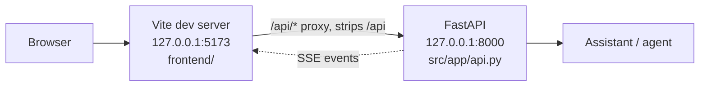

# Frontend: how the web app works and what we learned

This document explains the React chat app in [`frontend/`](../../frontend/): how it talks to the API, how streaming
and the live agent activity work, how citations are shown, and which gaps are known. The API it calls is described
in [`../assistant/assistant-insights.md`](../assistant/assistant-insights.md), and the agent's events in
[`../agent/agent-insights.md`](../agent/agent-insights.md).

## 1. How it fits together



In Docker, nginx in the `web` container takes the Vite server's place on port 8080 and forwards `/api/*` to the
`api` container (see the [container view](../architecture/2-containers.png)).

- **Stack:** React 19, TypeScript and Vite, with plain CSS and no UI library. Every version is pinned in
  `package.json`.
- **One origin.** The dev server forwards `/api/*` to the API, so the API needs no CORS settings and stays bound to
  `127.0.0.1`. To point it elsewhere, set `API_TARGET`.
- **No secrets in the browser.** The model and its key stay on the server. The app only sends `use_llm` and `mode`.

### Run it

Needs Node.js 20.19+ or 22.12+ (`node -v`; on macOS `brew install node`).

```bash
python -m src.app.api        # terminal 1: the API
cd frontend
npm install                  # once
npm run dev                  # terminal 2: open http://127.0.0.1:5173
npm run build                # type-check + production build into frontend/dist/
npm run preview              # serve that build, with the same /api forwarding
```

## 2. Files

| File | Role |
|---|---|
| `src/api.ts` | typed API client: `getHealth`, `getProducts`, `deleteSession`, and `streamChat`, which reads server-sent events from a `POST` with `fetch` (the browser's `EventSource` cannot send a request body) |
| `src/useChat.ts` | conversation state: messages, the server `session_id`, settings, streaming, stop, reset, and saving to `localStorage` |
| `src/activity.ts` | turns stage and tool events into plain language ("Comparing price and timer for …") and builds the step list |
| `src/useReveal.ts` | types out the verified answer progressively |
| `src/App.tsx` | layout, product names, auto-scroll, the products dialog |
| `components/Header.tsx` | name, API status and model, product count (opens the list), v2/v1 switch, "Use LLM", New chat |
| `components/MessageView.tsx` | one message: live activity, answer, sources, status chips, steps, the reason for a fallback |
| `components/AnswerText.tsx` | renders the answer: headings, lists, notes, **bold** and *italic*, code, and `[n]` source badges |
| `components/SourceList.tsx` | numbered source cards with an open-page button; a card expands to show the exact snippets |
| `components/Trace.tsx` | the live activity line and the folded "How the agent answered" steps |
| `components/ProductsDialog.tsx` | the supported products, by brand and price, with Ask and open-page buttons |
| `components/Composer.tsx` | the question box: Enter sends, Shift+Enter adds a new line, Stop while running |
| `components/Welcome.tsx` | starter questions on an empty chat |
| `src/styles.css` | the light theme, responsive layout, focus styles and reduced-motion support |

## 3. A message, from send to sources

1. **Send.** `POST /api/chat/stream` with `{question, session_id, use_llm, mode}`. The first event, `session`, sets
   the session id. Follow-ups send it back, which is how the server's memory knows the conversation.
2. **While working,** only one live line shows, with a spinner. It's built from the `stage`, `tool` and
   `tool_result` events:
   - **v1:** "Looking up the facts in the product data…", then "Verifying every claim against its source…".
   - **v2:** "Calling compare_products: comparing price and timer for Sonicare DiamondClean Smart 9300 and Oral-B
     iO Series 9 Genius…", then "compare_products → 16 value(s) found…", then "Deciding: call another tool, or
     write the answer…".
   
   Product ids are shown as short names, using the product list loaded at start.
3. **The answer types out.** The server sends an answer only after the guards have verified it, so the whole
   verified text arrives at once, and `useReveal` types it out in the browser. It never stops inside a `[1, 2]`
   marker, and it hides a half-finished `**` while typing.
4. **When typing ends,** the rest fades in:
   - the **source cards**;
   - **status chips:** answered, not found or refused; who wrote it (LLM, agent, code writer, or safe-writer
     fallback); "completed from sources" if it was repaired; the time taken;
   - the folded **steps:** "How the agent answered · N tool calls". Each model decision is shown ("Decided to call
     compare_products"), with the exact call as code and its one-line result. Revisions are marked in amber and tool
     errors in red;
   - **"Why the safe writer answered",** when a fallback happened.

## 4. Citations

The answer text cites numbered pages (`[1]`, `[2, 3]`), and each number is a button. Clicking a badge or a source
card toggles that card open. An open card shows:
- the page link;
- each cited section, with the **exact snippet text** the claim was checked against;
- the snippet ids.

The ↗ button on every card opens the page in a new tab, without expanding the card.

## 5. Settings and saved state

| Setting | Default | Notes |
|---|---|---|
| Mode | **v2 Agent** | v1 Pipeline is the other choice; a tooltip and the hint under the box give the model-call cost |
| Use LLM | **on** | off sends `use_llm: false`: deterministic answers, no model call, no quota |

- **Saved in the browser.** The chat, the session id and the settings are kept in `localStorage`
  (`oralcare-chat-v1`), up to the last 60 messages. A message that was still streaming when the page closed is
  dropped.
- **Defaults reach saved users too.** Saved settings carry a version. When the defaults change (Agent became the
  default), older saved settings are replaced once, and the chat history is kept.
- **New chat** clears the browser chat and deletes the server session.

## 6. Accessibility and responsiveness

- **Screen readers:** the live activity line is a `status` region, so the step is announced, not every typed
  character. Citation badges and buttons have labels, such as "Show source 2" or "Open source 1 (oralb.com) in a new
  tab". The products list is a native `<dialog>`, so focus handling and Esc come with it.
- **Keyboard:** everything works by keyboard, with visible focus rings.
- **Contrast:** text colours were chosen for at least 4.5:1 contrast on white. This was not measured with a tool.
- **Motion:** `prefers-reduced-motion` turns off animations, the typing reveal and smooth scrolling.
- **Small screens:** a single column, with the avatar and secondary labels hidden.
- **Auto-scroll:** the view follows the answer as it grows, but only while you are near the bottom. Scrolling up to
  reread is never interrupted.

These were built in, not checked with assistive technology. Full accessibility needs manual testing with screen
readers and an expert review.


## 7. Known gaps and risks

- **Not token-by-token:** streaming is a progressive reveal of an answer that has already been checked, not the
  model's raw tokens, on purpose. Long agent runs show a 10 to 30 second wait with only the activity line moving.
- **Typed text cut short:** the box accepts 2000 characters, but the server refuses questions over 600 as too long.
- **One tab per chat:** two tabs share `localStorage` but not their live state, and can overwrite each other's saved
  chat.
- **No automated UI tests:** only a strict type-check and the build. The step and activity wording were checked by
  running the logic on real traces in Node, not in a browser test suite.
- **Development setup only:** there is no production server setup (`npm run preview` is for checking a build), and
  no login.