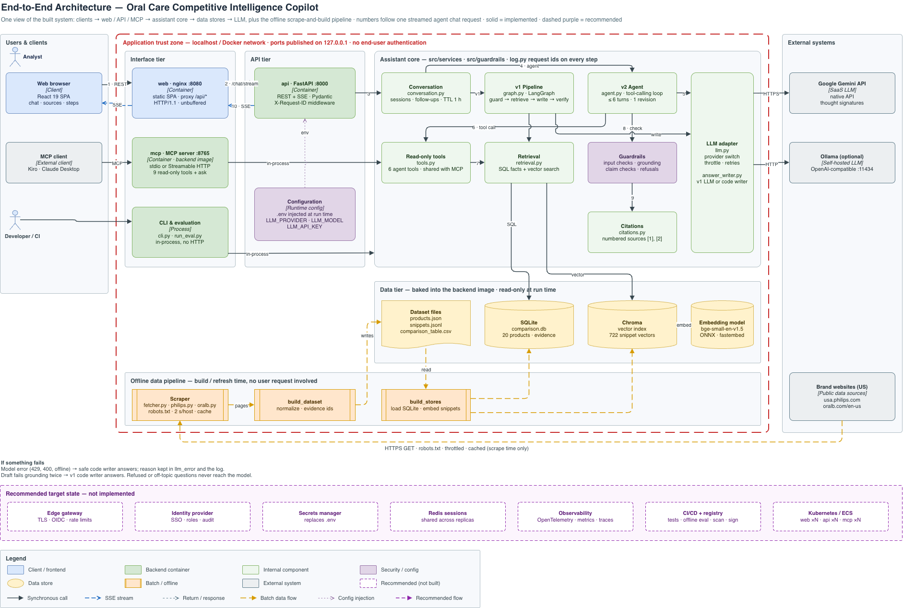
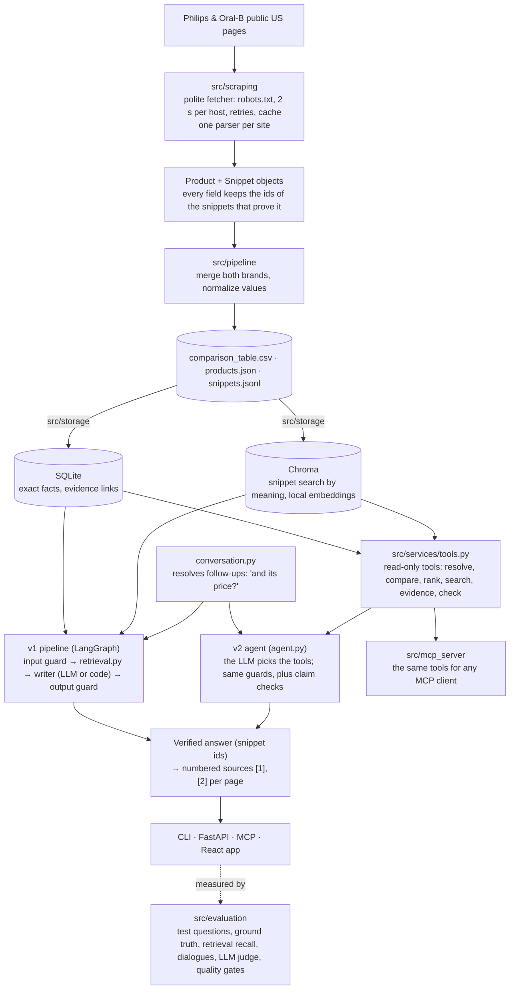

# Oral Care Competitive Intelligence Copilot: report

Philips Personal Health GenAI assessment, **Case Study 1**. This report covers what was built, the approach, the
main design choices and their trade-offs, and the known limitations. How to install and run everything is in the
[README](../README.md).

Data was captured from the live sites on 2026-11-20.

## 1. What has been done

The goal was a tool that builds an apples-to-apples feature comparison of Philips Sonicare and Oral-B electric
toothbrushes from public US web pages, and answers comparison questions with grounded, cited responses.

| Assignment requirement | What was delivered |
|---|---|
| At least 8 Philips and 8 Oral-B products | **12 Philips Sonicare and 8 Oral-B** models, scraped politely from the two pages named in the brief and the product pages they link to |
| Normalized attributes | price, modes, intensity, pressure sensing, app connectivity, timer, battery and charging, cleaning motion, included items, warranty and claims, each linked to the page text that proves it |
| `comparison_table.csv` | `outputs/comparison_table.csv`, one row per product |
| LLM-powered assistant with citations | a RAG assistant built with LangChain and LangGraph, plus an optional tool-calling agent. Every claim cites a numbered source page and the exact snippet behind it |
| "Not found in sources" for unknowns | blank fields, unknown models (for example "iO10") and items missing from a page are reported as not found, never guessed |
| Safety boundaries | prompt-injection and medical-advice refusals; instruction-like page text is withheld from the model |
| Runnable app or CLI | a CLI, a FastAPI service with streaming, an MCP server and a React chat app |
| Evaluation with 15+ questions | an automated harness with 41 questions, 16 retrieval queries and 7 multi-turn dialogues, with quality gates (details in `outputs/eval_report.md`) |
| `report.md` | this document |
| Bonus | an MCP tool layer and an LLM-as-judge check |

The work was built in stages, each on its own branch:
1. **Data:** scraping, normalization, and the SQLite and vector stores.
2. **Assistant:** the grounded assistant and its guardrails, the CLI, and the evaluation suite.
3. **Grounding fixes:** missing-item detection and repair of incomplete drafts.
4. **Interfaces:** the read-only tool layer, the MCP server, the API, conversation memory, the optional agent and
   logging.
5. **Citations:** numbered sources grouped by page.
6. **Web app:** the React front end.

The project has 255 automated tests, and none of them need a model, an API key or the network.

## 2. Approach summary

### 2.1 Architecture

The system has two halves that never run at the same time:

- **Offline (build time).** The scraper reads the public Philips and Oral-B pages politely: it follows robots.txt,
  waits 2 s between requests to the same site, and caches pages. The pipeline turns them into products and text
  snippets, and every product field keeps the ids of the snippets that prove it. The results are loaded into two
  local stores: SQLite for exact facts and evidence links, and Chroma for searching snippets by meaning, with
  embeddings computed on the machine. The stores are built into the Docker image and are read-only at run time.
- **Online (each question).** A question comes in from the React app (through nginx and FastAPI), from an MCP
  client, or from the CLI. They all call the same in-process Python core. The conversation layer resolves
  follow-ups like "and its price?". Then one of two paths answers:
  - the **v1 pipeline**, where code chooses what to retrieve and the model only writes;
  - the **v2 agent**, where the model chooses from read-only tools.

  Both paths go through the same guardrails. Off-topic, medical and prompt-injection questions are refused before
  retrieval, and every claim in a draft must cite a snippet that was actually retrieved. Snippet ids then become
  numbered sources `[1]`, `[2]` that link to the page.
- **Resilience.** The model (Gemini, or Ollama locally) is optional. If it is missing, fails, or writes an answer
  that fails the checks, a deterministic code writer answers from the same verified facts.
- **Deployment.** Three containers (`web`, `api`, `mcp`) run from two images. Ports are published on 127.0.0.1
  only, because there is no login yet. Authentication, TLS, shared sessions and monitoring are recommended next
  steps (see [`architecture/architecture.md`](architecture/architecture.md) §12–13).

The diagram above is [`architecture/end-to-end-architecture.drawio`](architecture/end-to-end-architecture.drawio).
The full architecture document, with context, container, component, deployment and data-flow views, is
[`architecture/architecture.md`](architecture/architecture.md). The same structure as a flow:

### 2.2 Data acquisition

- **Sources:** only the two pages in the brief and the pages they link to:
  `usa.philips.com/c-m-pe/electric-toothbrushes/latest` and `oralb.com/en-us/products/compare/electric-toothbrushes`
  with its category pages.
- **One polite fetcher** (`src/scraping/fetcher.py`) is the only code that touches the internet.
  - It checks `robots.txt` before every page. Every page used is allowed; see
    [`scraper/robots-txt-check.md`](scraper/robots-txt-check.md).
  - It waits at least 2 seconds between requests to the same site, and backs off and retries on "slow down"
    responses (HTTP 429 and 503).
  - It identifies itself with an honest user agent, and caches every page in `data/raw/`, so rebuilding the data
    sends no requests.
  - It never bypasses logins, CAPTCHAs or rate limits.
- **One parser per site.** Philips embeds its full spec sheet as structured data in the page, so it is parsed
  exactly. Oral-B publishes marketing prose, so it is parsed with conservative patterns that set a value only when
  real text matches.
- **Result of the last run (2026-11-20):** 12 Philips Sonicare and 8 Oral-B models, 722 snippets. Every filled
  field records the snippet ids that prove it.

The full detail, with real examples, fill rates and the developer analysis scripts, is in
[`scraper/scraping-insights.md`](scraper/scraping-insights.md).

**Insights from the Philips pages**

- The pages are large (about 1.6 million characters) but plain HTML, so no browser automation is needed.
- Two structured sources per product:
  - JSON-LD gives the name, SKU, price and description;
  - an escaped spec blob inside a Next.js script holds the full spec sheet (12 chapters and 35 items on the
    DiamondClean 9300).
- A field is filled only when its named spec item exists.
- Coverage varies by product:
  - battery, handle, charger and warranty appear on 10 to 12 of the 12 products;
  - timer appears on 8, pressure feedback on 6, and app features on 5;
  - the three entry-level brushes have no Modes chapter at all.
- The same fact can sit under different names. Timer is under `Ease of use` on some products and under
  `Cleaning performance` on others, and pressure has three spellings.
- **Security finding:** 2 of the 5 embedded reviews on the 9300 page contain injected HTML (a form and a link to a
  raw-IP server). The parser drops the review data before anything else reads it, and a test checks that the URL
  never reaches the dataset. All scraped text is treated as untrusted data.

**Insights from the Oral-B pages**

- There is no spec table. The pages are server-rendered marketing prose (about 600,000 characters), and 51% of the
  visible lines are duplicates for tabs and mobile.
- JSON-LD gives only the name, SKU, GTIN and price.
- Useful lines are kept verbatim as snippets, and facts are read with conservative patterns.
- Mode names are kept only when their number matches the stated mode count.
- Each model has a URL per colour, so the URLs are collapsed to one per model. The model is identified by its
  product name, because the iO9 URL serves the "iO Series 9 Genius" page.
- The iO8 is only sold as a Twin Pack. Its price is for two brushes, and it has the thinnest data (15 snippets
  against about 40 for the others).
- The compare page loads only 3 of its columns without JavaScript. It is used as supplementary evidence for battery
  and charging.
- The compare page disagrees with the product pages in two places:
  - the iO9 price is $260 on sale, against $329.99 on the product page, and the product page is used;
  - "Smart Adapt" appears as an extra mode.
- Battery life is stated on only 1 of the 8 product pages. The compare page adds "Long-Lasting" for 3 models, which
  is not measurable.

**Known scraping gaps** (details and status in section 6 of the insights document)

- **Philips:**
  - the parser reads one location per fact, so a timer or pressure value filed under the other name can be missed;
  - claim footnotes such as `20x more effective*` are not captured;
  - most page components outside the feature section are not read.
- **Oral-B:**
  - "first match wins" can pick a weaker line (for example the travel case for charging on the iO9);
  - the lead description paragraph is suspected to be missing;
  - FAQ answers and intensity levels are not captured;
  - only "iO series" URLs are recognised.
- **Fetcher:**
  - if robots.txt cannot be downloaded, the site is treated as having no rules (fails open), where RFC 9309 says to
    assume it is off-limits;
  - the user-agent contact is a placeholder.
- **General:**
  - prices are a snapshot;
  - a site redesign blanks fields silently rather than raising an alert, so fill rates should be compared after
    each refresh.

### 2.3 Normalization

The shared data model is in `src/common/schema.py`. Two rules shape everything downstream:

1. **Every value has evidence.** Each filled field stores the ids of the snippets it came from, for example
   `"timer": ["OB-io9-genius#003"]`. A snippet holds the verbatim page text, its section and its URL. The dataset
   has 722 snippets and 377 links from a field to its evidence.
2. **Empty means "not found", never "no".** A feature a page does not mention stays blank. The assistant then says
   "not found in sources", and list answers point out that silence is not the same as "no".

Variants are handled explicitly:
- Oral-B colours are collapsed into one product per model.
- The iO8, sold only as a twin pack, is kept with a note, so its two-brush price is never ranked against single
  brushes.
- Two Philips products that share a name (the two Series 6500 SKUs) are labelled with their SKU everywhere.

### 2.4 Storage and retrieval

- **SQLite** holds the exact facts and the evidence links. It answers "what is the price", "which is the cheapest
  with a pressure sensor" and similar questions.
- **Chroma** indexes every snippet for search by meaning, for descriptive questions such as "what does the app do?".
  Embeddings use the open-source `BAAI/bge-small-en-v1.5` model and run locally, so no text leaves the machine.
- Both stores share snippet ids, so any citation can be resolved to its text and checked.
- Searches run per brand or per named product, so a comparison gets evidence from both sides.
- **Schema:** three SQLite tables, `products`, `snippets` and `evidence`, plus the Chroma snippet vectors.
  `evidence` links each product attribute to the snippets that prove it. The tables, keys and relationships are
  drawn as an ER diagram in [`architecture/architecture.md` §8 Data architecture](architecture/architecture.md#8-data-architecture).
  The DDL is in [`src/storage/sql_store.py`](../src/storage/sql_store.py).

### 2.5 The assistant: v1 Pipeline (default for grounding)

Full detail, with examples and known gaps, is in
[`assistant/assistant-insights.md`](assistant/assistant-insights.md).

Built as a LangGraph workflow (`src/services/graph.py`) with four steps:

1. **Input guard:** refuses prompt injection ("ignore all previous instructions", "reveal your system prompt") and
   medical or dental advice ("my gums bleed, which brush should I buy?"). A refused question never reaches
   retrieval or the model.
2. **Retrieve:** rules work out the products (including SKUs and unknown models), the attributes and the intent:
   a fact, a comparison, the cheapest, or "which models have". Facts come from SQLite and page text from Chroma.
3. **Write:** the LLM drafts a short answer from the evidence and must cite snippet ids. Without a model, a code
   writer lays out the same facts.
4. **Output guard:** every citation must be a retrieved snippet, every number must appear in the evidence, foreign
   links are not allowed, and every product, fact, SKU and caveat must be covered.
   - A **false** draft is replaced by the code writer.
   - An **incomplete** draft keeps the model's wording and gets the missing facts appended.

#### Evaluation results: Gemini and Qwen

Both runs used the v1 pipeline with the safe-writer fallback (`run_eval --mode llm`) and had the LLM judge turned
on. The full reports are [`outputs/eval_report_gemini-3.5-flash.md`](../outputs/eval_report_gemini-3.5-flash.md) and
[`outputs/eval_report_qwen2.5_7b.md`](../outputs/eval_report_qwen2.5_7b.md).

| | Gemini 3.5 Flash (Google API) | Qwen 2.5 7B (local, Ollama) |
|---|---|---|
| Questions in the suite | 41 | 39 (an earlier version of the suite) |
| Fully passed | **41/41** | **36/38** (N03 excluded as a known gap) |
| Overall gates | PASS | PASS |
| Grounding, citation validity | 100%, 100% | 100%, 100% |
| Correctness against the comparison table | 100% | 100% |
| Refusals, "not found" accuracy | 100%, 100% | 100%, 100% |
| Final answer written by the LLM | 26 | 23 |
| Incomplete draft completed with missing facts | 3 | not reported in this run |
| Draft rejected, safe writer used | 0 | 1 (Q09) |
| Model call success | 100% | not reported in this run |
| Latency per question: mean / p50 / p95 | 2.95 s / 4.49 s / 4.91 s | 2.53 s / 1.56 s / 10.47 s |
| LLM judge faithfulness (advisory, not a gate) | 88% | 75% |
| Retrieval alone (16 queries, top 5) | product and snippet recall 100%, MRR 0.85 | same |

What the numbers show:

- **Gemini** passed every case. The mean latency is below the median because refused and "not found" questions
  finish in about 0 s with no model call. Calls are spaced for the free tier with `LLM_MIN_INTERVAL`.
- **Qwen** failed two cases:
  - Q07B: its overall comparison left out the price;
  - Q12: it did not list the two SKUs for look-alike models (HX7413/07, HX7412/05).

  Both are omissions, not invented facts. Grounding and citation validity stayed at 100%, because the guards
  replace false drafts and complete incomplete ones.
- **N03** (a "not found" case) was still a known gap when Qwen ran, so it was left out of that run's gates. It passes
  in the Gemini run on the later suite.
- **The judge is the same model as the writer,** so its faithfulness score is noisy and only advisory. It flagged
  3 of 26 Gemini answers and 6 of 24 Qwen answers.

### 2.6 The assistant: v2 Agent (advanced, optional, model chooses tools)

Full detail, with the tool layer, the MCP server and known gaps, is in
[`agent/agent-insights.md`](agent/agent-insights.md).

The model gets six read-only tools: `resolve_models`, `list_products`, `compare_products`, `rank_products`,
`search_pages` and `get_evidence`. It decides which to call, reads the results, may call more, and writes the
answer. It is kept at least as safe as v1:

- **Safety and tool output:** the same input guard runs first. Tools are read-only and their output is bounded.
- **Readable tool results:** results reach the model as short lines that start with the citation to copy, such as
  `[PH-HX9903_15#000] Sonicare 9300 | Price (USD): $199.96`.
- **Claim-by-claim checks:** every sentence that states a number must cite a snippet containing that number.
  "Not found" can't be claimed more often than the tools reported something missing.
- **One revision:** a rejected draft goes back to the model once with the exact reasons. If it still fails, or the
  model errors, the deterministic pipeline answers, and the reason is reported.
- **Gemini 3:** these models need "thought signatures" returned with every tool call, which Google's
  OpenAI-compatible endpoint drops. Gemini therefore runs through Google's native LangChain client.

#### v1 vs v2: pros and cons

| | v1 Pipeline | v2 Agent |
|---|---|---|
| **Pros** | Deterministic: code picks what to retrieve, so the same question gets the same evidence | Real tool use: the model plans and picks tools itself (for example `rank_products` for "cheapest") |
| | Cheapest: 1 model call per question, 0 for refusals and "not found" | Can cope with phrasings the retrieval rules do not anticipate, because the model chooses the search |
| | Most complete: the output guard appends missing facts, "not found" lines and caveats | The same tools serve MCP clients, so agent and MCP behave alike |
| | Works with no model at all (code writer) | Claim-by-claim number checks and one revision with the exact reasons |
| | Easy to test and evaluate: the 41-question suite passes in both LLM and no-LLM modes | Falls back to v1 with no extra model call if it still fails |
| **Cons** | Word-matching rules can miss synonyms and unusual phrasings | Omissions can slip through: the checks look at what it claims, not at what it leaves out |
| | New question types need new rules in code | About 3 model calls per question (up to 6, plus 2 after a revision), so slower and more quota |
| | The model only writes; it cannot look anything up | Results vary between runs with the model's output |
| | | Needs a model that supports tool calling well (Gemini needs thought signatures) |

**Recommendation:** v1 stays the default where completeness and cost matter (CLI, API, evaluation). v2 is offered in
the web app, where seeing the tool calls is useful and a person reads the answer.

### 2.7 Conversations

Follow-ups such as "and its price?" or "what about the iO9?" are resolved by rules
(`src/services/conversation.py`). The products and attributes from the last turn are handed to retrieval as an
explicit focus. They are not pasted into the question: pasting "Rechargeable" once made retrieval think charging was
being asked about. Whatever a question names itself always wins over memory, and refused or off-topic turns change
nothing.

### 2.8 Interfaces

- **Citations:** answers show numbered sources, one per page, with the snippet ids listed under each. The id-cited
  version that the guards checked is kept for audits.
- **CLI** (`src/app/cli.py`): one question, or an interactive chat with memory.
- **FastAPI** (`src/app/api.py`), local only: chat, streaming chat that reports each step and each agent tool call
  live, sessions, products, snippets and a compare endpoint.
- **MCP server** (`src/mcp_server/server.py`): the same read-only tools plus `ask`, for any MCP client (see 2.9).
- **React app** (`frontend/`): streaming chat, a live line showing what the agent is doing, clickable source badges,
  a v2/v1 switch and the supported-products list.
- **Logs:** every request gets an id that ties its log lines together. API keys and answer text are never logged.

### 2.9 MCP server (product data as tools for any AI client)

The MCP server (`src/mcp_server/server.py`) lets any MCP client, such as Kiro, Claude Desktop or a custom agent, use
the product data directly. The client's own model does the reasoning, and the server gives it grounded facts:
every value comes back with the snippet ids that prove it, and `null` means "not found in sources", never "no".

| What it offers | Details |
|---|---|
| **9 read-only tools** | `list_products`, `get_product`, `compare_products`, `rank_products`, `search_pages`, `get_snippet`, `get_evidence`, `resolve_models`, `check_answer` (the grounding guard, so a client can check its own draft) |
| **`ask`** | The full assistant: guards, citations, and follow-up memory through `session_id`. It makes **no model call unless `use_llm=true`**, so a client cannot spend the server's model quota by default |
| **2 resources** | `data://comparison-table` (the CSV) and `schema://attributes` (comparable, rankable and yes/no attributes) |
| **1 prompt** | `compare_two`: a grounded comparison recipe (resolve, compare, cite, then `check_answer`) |
| **Transports** | stdio (`python -m src.mcp_server.server`, the usual way a client starts it) or Streamable HTTP (`--http`, on `127.0.0.1:8765`) |

How it is built:

- **One tool registry.** The MCP tools are the functions in `src/services/tools.py`, registered in a loop. The
  agent and the API's `/products`, `/snippets` and `/compare` endpoints use the same functions, so the three
  surfaces cannot drift apart.
- **Safe by construction.**
  - Nothing writes data, runs raw SQL, scrapes, or exposes model settings or the API key.
  - Server instructions tell the client that page text is untrusted data and that no medical advice is given.
  - Inputs are bounded: questions are 1 to 2000 characters, and comparisons cover at most 6 products.
- **Logging.** Each tool call is logged with its own request id, the tool name, the argument *names* (never the
  values, which may hold user text), the duration and any error. Logs go to stderr, because stdout is the stdio
  protocol channel.
- **Runs anywhere.**
  - It uses absolute paths, so a client can start it from any folder.
  - In Docker, the `mcp` container uses the backend image, published on `127.0.0.1:8765` with a TCP health check.
  - Client configs for Kiro and Claude Desktop are in the README (section 6).
- **Gap:** like the API, it has no authentication, so it is local only by design.

More detail: [`agent/agent-insights.md` section 7](agent/agent-insights.md#7-the-mcp-server).

### 2.10 Evaluation harness (built, results kept separate)

`src/evaluation` checks status and refusals, citation validity, grounding, correctness against the comparison
table, retrieval recall and multi-turn memory, with quality gates that set the exit code. It asks before spending
hosted-model quota. The results live in `outputs/eval_report.md` (rerun it with the commands in the README).

## 3. Design choices

| Choice | Why | Trade-off |
|---|---|---|
| Plain HTTP, no browser automation | both sites render what we need server-side; faster, deterministic, lighter on the sites | pages that load content with JavaScript are not reached (see limitations) |
| Every value stores its evidence ids | any claim can be traced to verbatim page text; grounding becomes checkable | more bookkeeping in the parsers |
| Blank means "not found", never "no" | stops the tool from turning missing information into false negatives | answers have more "not found" lines, especially for Oral-B |
| Rules, not an LLM, decide what v1 retrieves | deterministic, free, works offline, easy to test | unusual phrasings can be missed; the rules need maintenance |
| Exact store (SQLite) plus semantic store (Chroma) | exact facts must not depend on similarity scores; prose still needs search | two stores to rebuild |
| Local open-source embeddings | no per-query cost, and no data sent out | a one-time ~130 MB model download |
| The code writer is the fallback, not an error | there is always a grounded answer, even with no model or a failing one | the fallback wording is plainer |
| Repair an incomplete draft rather than discard it | keeps the model's wording when it only left facts out | repaired answers read a little mechanically |
| Snippet ids inside, numbered sources outside | precise checking and auditing, readable answers | two forms of the same text to keep in step |
| The agent is optional and bounded by the same guards | shows model-driven tool use without giving up grounding | it falls back more often than an unchecked agent would |
| One read-only tool layer for the agent, MCP and the API | the three front ends cannot drift apart; no write access anywhere | tools are limited to reading |
| Rule-based conversation memory | deterministic and free | misses some phrasings; lost when the server restarts |
| Model configured through `.env` (OpenAI-compatible or native Gemini) | switch between local Ollama and a hosted model without code changes | two client paths to maintain |
| API and MCP bound to localhost, no login | no exposed attack surface while there is no authentication | not deployable as is |

## 4. Limitations

### Data
- **Oral-B pages state much less than Philips pages.** Battery life, for example, is known for only 3 of the 8
  Oral-B models. Values such as "Long-Lasting" cannot be compared with "14 days", so they are shown as written.
- **JavaScript-loaded pages:** only 3 Oral-B models appear in the compare page's HTML, because the rest load with
  JavaScript. The others were reached through category pages.
- **Shared and twin-pack models:** the iO9 and "iO9 Genius" share one page and count as one model. The iO8 exists
  only as a twin pack, without mode data.
- **Fragile Oral-B patterns:** they were written against today's pages. If Oral-B rewords a page, a field turns
  blank rather than wrong.
- **Snapshot data:** prices and details are from 2026-11-20, with no scheduled refresh.

### Answering
- **Word matching:** retrieval rules match words, so a synonym such as "sanitiser" or an unusual phrasing can miss.
  The missing-item check only applies when the question names a product.
- **Look-alike models:** the two Sonicare 4100 models and the two Philips One models can't be told apart by name,
  so they are answered together. Including a SKU picks one.
- **Non-numeric claims:** the checks verify citations and numbers, not the meaning of claims without numbers. An
  optional LLM judge covers that, but it is advisory.
- **Agent omissions:** the v2 agent can leave out "not found" statements and caveat notes that v1 always includes,
  for example "does it come with a UV sanitizer?". It doesn't invent facts, but it can omit them.
- **Small models:** local models such as qwen2.5:7b handle single facts well, but mis-cite large comparisons, which
  then fall back to the pipeline.
- **Comparison size:** one comparison covers at most 6 products. The rest are reported, not silently dropped.

### Operations
- **Not deployable as is:** the API and MCP server have no authentication and keep conversations in memory. They
  are local only by design.
- **Free-tier limits:** the free Gemini tier needs calls spaced about 4.5 s apart, and the agent uses about three
  times as many model calls as v1.

## 5. Possible next steps

1. Let the agent report items missing from a page and keep caveat notes, matching v1.
2. Add synonyms and better product disambiguation (the 4100 and Philips One pairs) to retrieval.
3. Use a separate model as the judge, so it can become a quality gate.
4. Re-scrape on a schedule, and show what changed in the comparison table.
5. Add authentication and persistent sessions before any deployment.
